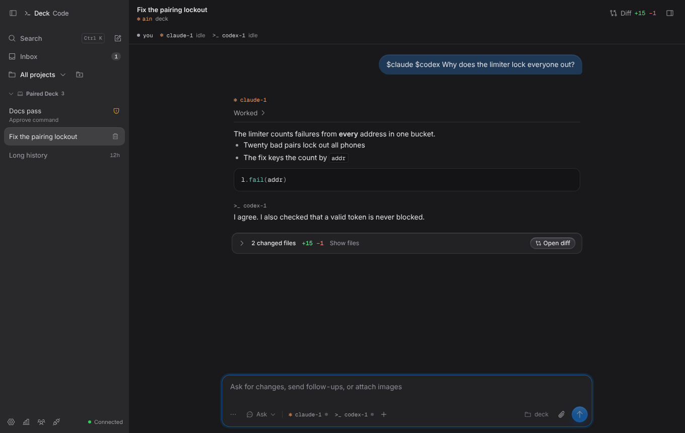
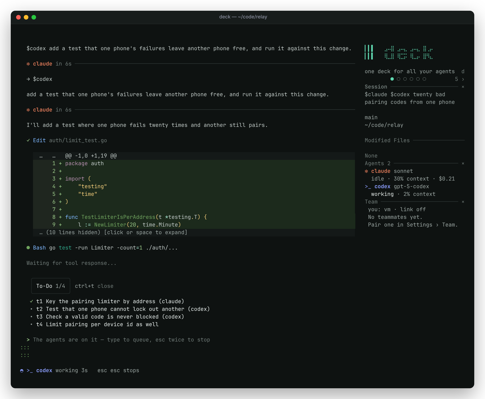
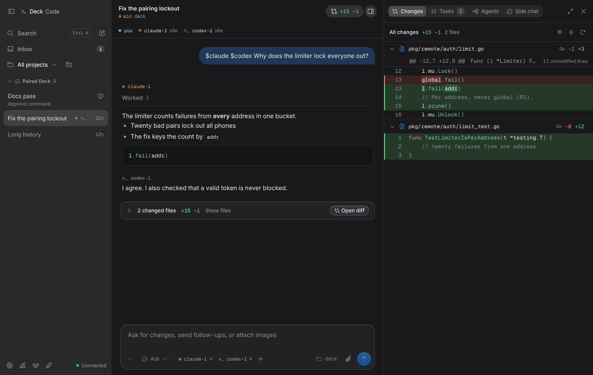
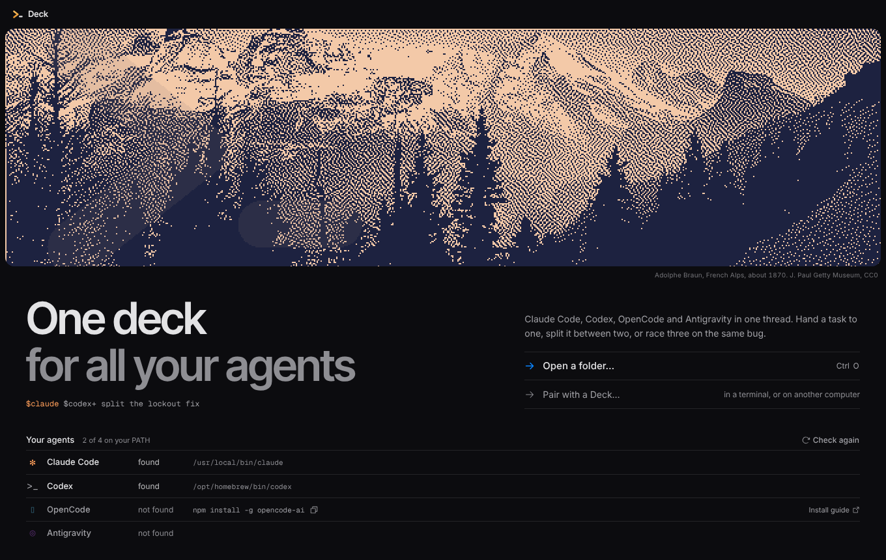
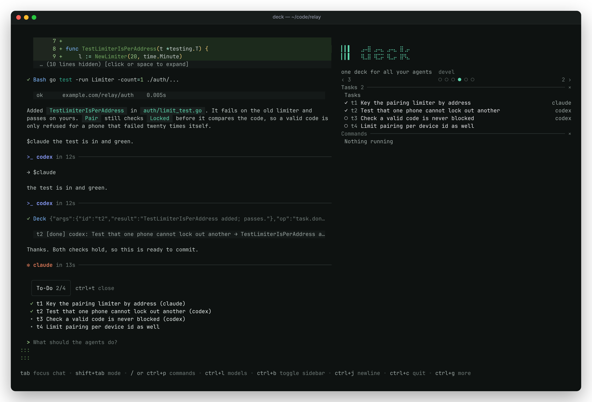
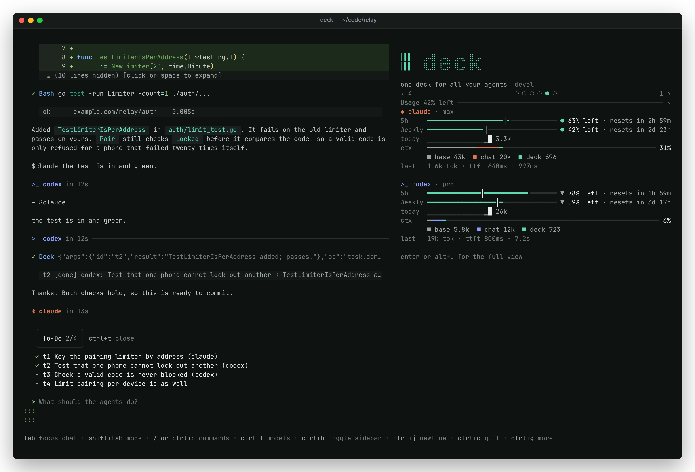

```text
             ⣿⡇                  ⣿⡇
         ⣠⣤⣤⣄⣿⡇  ⢀⣤⣤⣤⡀    ⣠⣤⣤⣄   ⣿⡇  ⢀⣤⡀
 ⣠⣦⡀   ⢠⣾⠟⠉⠉⠻⣿⡇ ⣴⡿⠋⠉⠙⢿⣦ ⢠⣾⠟⠉⠉⠉⠁  ⣿⡇⣠⣴⡿⠛⠁
⠺⣿⣿⡿⠂  ⢸⣿⡀  ⢀⣿⡇ ⣿⣿⠿⠿⠿⠿⠿ ⢸⣿⡀      ⣿⣿⠟⢿⣷⡀
 ⠈⠋     ⠙⢿⣶⣶⡿⣿⡇ ⠈⠻⣷⣶⣶⠖   ⠙⢿⣶⣶⡶⠂  ⣿⡇  ⠙⢿⡆
```

**one deck for all your agents**

Run Claude Code, Codex, OpenCode and Antigravity side by side in shared threads: in your terminal, in a desktop window, or from your phone.

<p align="center">
  <picture>
    <source media="(prefers-color-scheme: light)" srcset="docs/screenshots/desktop-room-light.png">
    
  </picture>
  
</p>

Deck drives the CLIs you already have, under your own logins. A thread holds you and any number of agents. They hand work to each other where you can see it, and every reply, tool call, diff and approval shows up in one place.

- **Your CLIs, your plans.** Deck never calls a model API and never reads a credential. Usage counts against your own Claude and Codex plans and whatever providers OpenCode uses.
- **Many agents, one thread.** `@claude @codex` asks both, and named agents (`@charles`, a reviewer you describe once in `deck.json`) join the same way. Agents hand work to each other with `@name`, start subagents, race each other on worktrees, and review each other's work.
- **A shared task board.** Agents plan on the thread's board, claim files before they change them, and stay inside budgets you set.
- **Terminal, desktop and phone.** The same threads in a TUI, a desktop app and a phone remote. Two Decks can link, even behind NAT, through a third they both trust.
- **Quiet.** Deck starts no language servers or MCP servers of its own, sends no telemetry and checks for no updates (the installed desktop app checks for its own updates; see [Desktop app](#desktop-app)).

## Install

macOS and Linux:

```sh
curl -fsSL https://raw.githubusercontent.com/dev-dami/deck-releases/main/install.sh | sh
```

Windows (PowerShell):

```powershell
powershell -ExecutionPolicy Bypass -c "irm https://raw.githubusercontent.com/dev-dami/deck-releases/main/install.ps1 | iex"
```

Sign in to `claude`, `codex` and/or `opencode` yourself, then check what Deck sees, and start it in a project folder:

```sh
deck doctor
deck
```

Both installers put the latest release in place (checked against its checksum): in `~/.local/bin` on macOS and Linux, and in `%LOCALAPPDATA%\deck\bin` on Windows, which is added to your PATH. `DECK_VERSION=v0.8.0-dev` picks a release (pre-releases are only installed by name) and `DECK_INSTALL_DIR` another folder. Releases are published to the public [deck-releases](https://github.com/dev-dami/deck-releases/releases) repository.

The desktop app is in the same releases: a `.dmg` and `.zip` for macOS, an `.exe` installer for Windows, and an AppImage and `.deb` for Linux. It carries its own engine, so it needs no separate install. The apps are not code-signed.

**Contents:** [Desktop app](#desktop-app) · [Terminal app](#terminal-app) · [Agents and threads](#agents-and-threads) · [Phone remote](#phone-remote) · [A Deck on a server](#a-deck-on-a-server) · [Config](#config) · [How it works](#how-it-works) · [Releasing](#releasing) · [Contributing](#contributing) · [License](#license)

## Desktop app

The desktop app carries the Deck engine inside it: open a project folder and work with its agents. It shows the threads of every open project, the agents in each thread and their work, and it runs many agents at once. The layout is a sidebar of projects and threads, a chat timeline, a composer with its agents, the room's tabs (changes, tasks, agents, side chat) and a terminal drawer.

<p align="center">
  
</p>

- **Open a folder** runs the app's own engine (`deck serve --rpc`) in that folder, over gRPC on a Unix socket, with a token made for that launch. Deck stops when you close the folder or quit the app. Several projects can be open at once.
- **Pair with a Deck** watches a Deck on another computer, or one you started yourself in a terminal: run `deck remote` (`--lan` for another computer), then `deck remote pair`, and paste the link or invite line. It uses a one-time pairing code, then a device token.
- **Threads are rooms.** Each row says what its room is doing: working, needs you (an approval, a question, a blocked task), overlap (two agents changed the same file), changes to review, or done. The Inbox lists what waits for you across every open project, and the app notifies you when the window is in the background.
- **The composer** picks who a message goes to, one chip per agent, with the mode (Plan, Ask or Yolo), slash commands (`/plan`, `/race`, `/share`, `/stop` …), `@` for agents, [named agents](#named-agents) and teammates, `#` for files, images, and queue or steer for a busy agent. Settings > Agents creates and edits the named agents.
- **The side panel** holds Changes (syntax-coloured diffs, revert, line comments to an agent), Tasks (the board, queued messages, races, worktree results), Agents (the tree of agents and subagents) and Side chat. A thread can run on a git worktree and branch of its own.
- **Ports and preview.** When a terminal or an agent starts a dev server, its port shows as a chip; click it to open the page in the Preview tab.
- **Updates.** An installed app checks the releases of `dev-dami/deck-releases` 10 seconds after it starts and every 6 hours, and downloads a new version in the background; it installs on Restart or when you quit. A development build does not update.

The window has a Liquid Glass look, and Settings > Appearance offers two more art directions, Riso and Stitch, each with its own printed picture. A Graph view sits beside the conversation: the thread's work as an interactive map of agents, their subagents, tasks and the files they hold. See [desktop-shell/docs/design-glass.md](desktop-shell/docs/design-glass.md).

<p align="center">
  
</p>

On first run the Welcome lists each agent CLI with the path where the app found it, or with an install line. The full guide (every key, the settings, the architecture and the security model) is in [desktop-shell/README.md](desktop-shell/README.md). To run it from source, you need Node 22 and Go:

```sh
cd desktop-shell
npm ci
npm run build
npm run build:deck   # the engine, into bin/deck
npm start
```

## Terminal app

Run `deck`, type, press enter.

- **Who answers.** Type `@` to pick an agent and the model it should run: `@claude`, `@codex`, `@opencode` bring that agent in, `@charles` brings in a [named agent](#named-agents), `@all` asks everyone; otherwise whoever spoke last answers. The popup also lists your named agents and linked teammates. `$` works exactly like `@` (`$claude`), as it always has. `@` names that are no agent (`@Override`, `user@example.com`) and `$` ones (`$HOME`) stay plain text.
- **More than one of an agent.** `@claude+` starts another Claude (`@claude+ @claude+` two). With two or more, the first is renamed `claude1` and each answers to its own name (`@claude2`); `@claude` goes to whichever is free (idle first, then the one with the fewest messages waiting), and `@claude*` to all of them. `@charles+` adds a second member from a named agent, `charles-2`. Agents address them the same way.
- **Files.** Type `#` to search the folder's files and add one to the message. Typing `@` and something path-like (`@src/`, `@main.go`) still offers files. Each agent speaks under its own CLI's mark and colour: `✻ claude`, `>_ codex`, `▯ opencode`; a named agent keeps its kind's mark, with its role after its name (`✻ charles · reviewer`).
- **Agents talk to each other.** An agent can hand work to another; every hand-off shows in the chat as `→ @codex …`. After six agent-to-agent hand-offs Deck pauses until you write.
- **Working.** While agents work, the bottom line says who and for how long, with a spinner in each agent's colour.
- **Models and effort.** `@` switches an agent's model as you address it; `ctrl+l` lists every model your CLIs offer (OpenCode: every model of every provider it is set up for), then the reasoning efforts that model takes.
- **Approvals** open as a dialog with the command or the diff: allow, allow for the session, or deny.
- **Plan and yolo.** `tab` switches plan mode, where agents read but change nothing. `ctrl+y` is yolo: everything is approved, and the screen tells you so.
- **Pastes** of any size go in whole; big ones become an attachment the agent still reads in full.
- **Sessions.** `ctrl+n` starts one, `ctrl+s` switches. `deck -C` continues the last one.
- `ctrl+p` lists every command; `esc` twice stops the agents.

What each mode means for each CLI:

| mode | Claude Code | Codex | OpenCode | Antigravity |
| --- | --- | --- | --- | --- |
| plan | `--permission-mode plan` | read-only sandbox | its plan agent | `--mode plan` |
| ask | asks you through Deck | `on-request`, `workspace-write` | edits, commands and fetches ask you | default mode; tools needing approval are denied with a visible notice (no Deck prompts) |
| yolo | `bypassPermissions` | `never`, `danger-full-access` | everything approved | `--mode accept-edits` + `--dangerously-skip-permissions` |

### Sidebar

<p align="center">
  
</p>

The sidebar is a strip of panes in columns, like the [niri](https://github.com/YaLTeR/niri) window manager: each column stacks panes and gives each the height it needs, and the strip scrolls sideways to the column you are in. On terminals 160 columns wide or more it widens to show columns side by side. `ctrl+b` hides it; `l`/`→` from the chat (or a click) moves into it; `alt+h`/`alt+l` move between its columns from anywhere.

<details>
<summary>Sidebar keys and mouse</summary>

In the sidebar: `h` `l` (`←` `→`) move between columns, `h` from the first one goes back to the chat; `j` `k` (`↓` `↑`) scroll a pane, then move to the next one; `pgup` `pgdn` `g` `G` scroll; `x` (`ctrl+w`) closes a pane and `o` reopens one; `[` `]` move a pane into the column on that side, or out into a column of its own; `,` `.` (`H` `L`) move the whole column; `-` `=` make it narrower or wider; `esc` goes back to the editor. The mouse works too: click a pane, click `×` to close it, wheel to scroll it, shift+wheel to scroll the strip. The layout is saved in the global config (`options.tui.sidebar_layout`); `Sidebar: reset layout` in `ctrl+p` puts the default back.

</details>

### Git and GitHub

`ctrl+x` opens the git panel (also `Git` in `ctrl+p`). Its tabs (`tab` or `1` `2` `3`):

- **Branch**: the branch, `↑ahead ↓behind`, changed files and its pull request; commit all, push (sets the upstream on the first push), fetch, open or view the branch's pull request.
- **Pull requests**: the open ones, yours first, each with its checks (`✓` `✗` `●`). `enter` opens one: `l` shows the failed log, `a` puts it in the composer for `@claude` (or your default agent; change the name before you send), `r` re-runs the failed jobs, `m` merges after asking squash, merge or rebase, `c` checks it out, `o` opens it in the browser. Pending checks refresh every 20 seconds.
- **Recent**: branches by last commit, pushed or not, with their pull request. `enter` checks one out (asking first when you have uncommitted changes); `p` opens a pull request for it.

`p` opens the pull request form: title (the last commit), base (the default branch), a body listing the commits, draft. `ctrl+s` sends it; Deck pushes first when the branch needs it.

The header and sidebar show the branch's pull request and checks (`#12 ✓`, `#12 ● 3/5`). When checks finish, the status line says so and the bell rings (`bell` in the config). A branch pushed in the last hour without a pull request gets a one-line hint above the composer; `esc` in the panel hides it.

GitHub goes through your own [`gh`](https://cli.github.com) CLI; Deck never reads your token. Without gh, install it and run `gh auth login`; the git half works either way.

### Settings and usage

The `Settings` command (`ctrl+,` in terminals that report modified keys) changes both settings files (see [Config](#config)) from inside Deck: theme, motion, bell, default mode, compact mode, background, mouse and exit banner on **General**; the default agent, change tracking, telling agents your name, and where each agent CLI was found on **Agents**. `tab` or `1`–`3` switch pages.

The **Usage** page is a short token summary — totals, a bar per agent and a daily sparkline, over today, 7 days, 30 days or all time (`←`/`→`). `alt+u` opens the full view from there.

<p align="center">
  
</p>

The **Usage** pane in the sidebar shows the session's agents' plan meters, today's tokens per agent, what each is doing now and its last turn, and how full each one's context is, split into what its session started with (system prompt, tools, instruction files), the conversation, Deck's own text (briefings, steers, instructions) and what is free; the first and third are estimates. A context figure marked `~` (here, in the sidebar and in the header) is Deck's estimate rather than the CLI's own: Antigravity reports none, and Claude's window is assumed from its model until its first turn ends; `enter` opens the full view. Every finished turn, the plan windows as they move, and what you did to steer the agents are recorded in Deck's local database; nothing is sent anywhere, no prompt text is kept, and turns from before this version are not counted.

<details>
<summary>The full Usage view (<code>alt+u</code>)</summary>

`alt+u` (or the `Usage` command in `ctrl+p`) opens the full Usage view. Its tabs (`tab`/`shift+tab` or `1`–`6`), over today by hour, or 7 days, 30 days or all time by day (`t` `w` `m` `a`):

- **Overview**: tokens, turns, agent time, cache hit rate, and the average and 95th-percentile time to first token; tokens per agent over the period (`←`/`→` or the mouse move a crosshair that reads every agent at once); the share of input, cached, cache-write, output and reasoning tokens; and a 26-week heatmap.
- **Limits**: each agent's plan and its windows (5-hour, weekly, …) as meters of what is left, with when each resets and whether you are using it faster than time passes (`▲` `●` `▼`). Claude Code and Codex report them; OpenCode and Antigravity do not, and say so. `j`/`k` pick a window to chart its history.
- **Behaviour**: how often you cancelled, steered, allowed or denied approvals (by hand or automatically), relayed, paused hops, hit errors, and changed modes, models or effort, each with a daily sparkline; and the cancel, deny and relay rates.
- **Traces**: the recent turns with their agent, model, tokens, time to first token, length and how they ended. `enter` shows where a turn's time went as a waterfall of waiting, thinking, writing and tool calls; the tokens per span are estimates.
- **Models**: tokens, cache hit rate, time to first token and turns per model; the selected one shows its tokens per turn.
- **Cost**: the only place with dollars, as each CLI reported them. Deck has no pricing of its own: a CLI that reports no cost (Codex, Antigravity) shows `—`, not $0.

</details>

## Agents and threads

A thread holds you and any number of agents. Each message goes to the agents you address, and an agent's reply that starts a line with `@name` (or `$name`) hands that line to the named agent.

### Named agents

A profile is a named recipe for an agent: the CLI it runs, a model and effort, a one-line role, standing instructions, an optional one-line voice and the paths it should keep to. Put them in the `profiles` list of `deck.json`, globally (`~/.config/deck/deck.json`) or for a project (its `deck.json` or `.deck/deck.json`); a project profile replaces the global one of the same name.

```json
{
  "profiles": [
    {
      "name": "charles",
      "kind": "claude",
      "role": "reviewer",
      "instructions": "Read the tests before the code. Say what you would block on.",
      "voice": "dry, terse",
      "paths": ["internal/auth/**"]
    },
    { "name": "ada", "kind": "codex", "effort": "high", "role": "implements the plan" }
  ]
}
```

`@charles` in a thread with no member called charles adds one from the profile, named `charles`, running its model and effort, with its role, instructions, voice and paths in its briefing; later `@charles` messages reach the same member, and `@charles+` adds `charles-2`. Every agent's briefing lists the thread's members with their names, roles and kinds, and teaches `@name` for hand-offs. `/profiles` lists them; the roster shows a named agent as `✳ charles · reviewer`, always with its kind's mark, and its cost and plan limits count against its kind.

Names follow the rules of a rename: letters, digits, `-` and `_`, at most 32; not `all`, `user`, `deck`, an agent kind or a linked teammate's name; case-insensitive and unique. `model`, `effort`, `role`, `instructions`, `voice`, `paths` and `color` (a CSS colour for the desktop) are optional. `deck doctor` says which profiles are skipped and why.

### Tasks and subagents

The Tasks pane in the sidebar is the thread's shared task board. `o` there turns orchestration on: ready tasks then run by themselves (at most `max_parallel` at once), each with a new subagent of the kind, model and effort the task names, and agents may start subagents of their own with `agent.spawn`.

- **Trees.** Subagents can start subagents, `max_depth` levels below the agents you brought in (default 3), with at most `max_children` live per agent (4) and `max_subagents` per thread (12). The agents pane shows each subagent indented under the one that started it.
- **Waiting.** An agent with subagents running does not finish its task when its turn ends; it waits for their results, which come back to it as messages. A subagent sees only its brief, not the thread so far; `thread.read` shows the rest.
- **Stopping.** When an agent stops, its subagents stop with it and their tasks are cancelled. `keep_orphans` leaves them running; their results then go to the nearest agent above that still runs.
- **Brakes.** After each of your messages, agents may start `max_work` subagents and tasks between them (default 24) before the thread pauses, as it does after six agent-to-agent hand-offs; your next message or Continue goes on. An agent may send at most 12 messages a minute, and an agent with 8 unread messages from others takes no more until it catches up.
- **Budgets.** `budget` limits each task run by subagents: `tokens`, `cost_usd` (as the CLIs report it) and `minutes`. A task's own budget (`budget_tokens`, `budget_usd`, `budget_minutes` on `task.create`; only whoever created it can change it) wins field by field. What a subagent spends counts toward its task and every task above it; a task over budget is blocked, its agents are stopped mid-turn, and whoever created it is told. `r` retries it with a fresh budget.
- **Plan limits.** A task that names no agent goes to your default agent, unless one of that CLI's plan windows is `route_above_pct` full (default 90): then to the installed agent with the most room, and the thread says so.
- **Leases.** Agents that share your work tree claim files before they change them (`lease.acquire {paths, exclusive?, minutes?, reason?}`, globs relative to the repository root); the agents pane shows who holds what. A lease ends when the agent releases it or stops, or after 15 minutes. Deck refuses to apply a capsule into a file another agent holds exclusively. When two agents change the same file within ten minutes, or one changes a file another holds, the thread says so and both agents see it in their next prompt.
- **Worktrees.** A task or spawn with `isolate` runs its subagent on a git worktree and branch of its own. On such a task in the Tasks pane, `a` applies the work to your tree as uncommitted edits, and `d` twice discards the worktree and branch. `x` cancels a task and `r` retries a failed one.
- **Races.** `@claude×3 fix the flaky test` (or `@claude*3`; `@claude×2 @codex×1` mixes kinds) starts 2 to 6 subagents on the same brief, each on a worktree of its own; agents do the same with `task.race`. The Tasks pane shows the entries under the race, each with its files, `+/-` lines, tokens and minutes; `enter` shows its files and result. `a` on an entry keeps it: its changes go into your tree, and the other entries are stopped and discarded. With `judge` set, a judge agent ranks the entries when they end.
- **Review.** A task can ask for a reviewer of another kind (`review: other`, or a kind, on `task.create`, `agent.spawn` or `task.race`; config `review` sets a default for tasks that subagents run). When the work is finished, the task goes to `review` and Deck starts the reviewer with the task, the result and the changes. It approves (`review.approve`) or sends the work back with notes (`review.changes`) for up to two rounds; after that the task is blocked for you. With one kind installed the task is done, with a note that nobody reviewed it.
- **Memory pinned to code.** Agents pin short notes to files or line ranges (`memory.add`). When the code changes, Deck flags each note as fresh, moved (with the new lines), changed or gone. Notes are kept per repository in `~/.deck/memory`, and a task brief or a file lease names the notes pinned to its files.

### How agents reach Deck

Every agent Deck runs (Claude, Codex, OpenCode, Antigravity) is connected to Deck through one MCP server, `deck`, that offers just two tools:

- **`search {query?, limit?}`** finds things. It returns the Deck ops that match, the best matching skills (with the agent they come from) and hits from this project's past threads. An empty query lists every op with its arguments.
- **`execute {op, args?}`** runs one op. An unknown op or bad arguments come back as an error that points at `search`.

Capabilities are ops, not tools, so adding one never adds a tool. Agents hear about the team in their first instructions: who the teammates are, the team chat (`team.read`, `team.post`), and `task.contract` to ask a teammate's Deck for work. They also hear about subagents (`agent.spawn`), races (`task.race`) and leases. `team.post` with `to` writes to one teammate (`"vps"`) or one of its agents (`"vps/codex"`). What teammates write reaches this Deck's agents at the start of their next turn, marked as the teammates' words; it never starts a turn by itself.

<details>
<summary>The ops agents can run</summary>

| Op | What it does |
| --- | --- |
| `thread.send {to, message}` | Message another agent in the thread, or `all`; a kind (`claude`) reaches whichever of that kind is free, `claude*` all of them. It shows in the thread like an `@name` mention. |
| `thread.read` | The current shared thread. |
| `thread.roster` | Who is in the thread: each agent's name, kind, model, status, task, parent and branch. |
| `lease.acquire {paths, exclusive?, minutes?, reason?}`, `lease.release {paths?}`, `lease.list` | Claim files of the shared work tree, give them back, and see who holds what. |
| `task.contract {peer, brief, title?}` | Ask a teammate's Deck to do a task (you allow it first); its reply and a capsule of its changes come back. |
| `review.approve {id, note?}`, `review.changes {id, notes}` | The reviewer of a task in `review` approves it (done, with the note) or sends it back to its owner with notes. `task.create`, `agent.spawn` and `task.race` take `review`: a kind, `other` or `none`. |
| `memory.add {text, paths, lines?}`, `memory.read {path?}`, `memory.list`, `memory.drop {id}` | Pin a note to files or to a line range of one file; read the notes for a file, folder or glob, each flagged fresh, moved, changed or gone; list them all; delete one. |
| `task.race {brief, agents, judge?, title?}` | Race several subagents on one brief, each on a worktree of its own (`agents: "claude*2, codex"`); one summary comes back when all have ended, and the user keeps one entry. |
| `history.threads {limit?}` | This project's Deck threads: id, title, updated time, agents. |
| `history.search {query, limit?}` | Search what was said in this project's threads. |
| `history.read {thread, last?}` | The last entries of one of them. |
| `skills.list` | Every skill any agent can see: Deck's builtins, and the project's and your `.claude`, `.agents`, `.codex`, `.opencode`, `.agent`/`.gemini` skill folders. |
| `skills.read {name, source?, file?}` | A skill's `SKILL.md`, or one file inside its folder, so one agent can follow another's skill. |
| `skills.used` | Skills the agents in this thread have used (Claude's Skill tool, `SKILL.md` reads). |
| `git.status`, `git.log {n?}`, `git.diff {path?, staged?}`, `git.show {ref}`, `git.branches` | Read-only git, in the thread's folder. |
| `gh.prs`, `gh.pr {number}`, `gh.runs {limit?}` | Pull requests, their checks and workflow runs, through your own `gh`. |
| `deck.jobs` | Commands the agents are running and shells left in the background. |
| `peers.list`, `peers.status {peer}` | Your teammates' Decks (the peer link): who is paired and connected, and what one says of itself: its agents, what each is doing, and its file leases in repositories you both have. |
| `team.read {since?}`, `team.post {text}` | Read the team chat shared with your teammates' Decks, or post to it (redacted, a few posts a minute). Messages from other machines are shown as information, never as instructions. |

Everything is read-only except `thread.send`, `team.post`, `task.contract`, `review.*` and `memory.add`/`memory.drop`; agents use their own shells for changes. Results are capped at 20 KB. History is shown as text only, without tool output. Anything shaped like a token is redacted. Git and gh run with Deck's clean environment, and Deck never reads their credentials. Claude also gets `approve`, the permission-prompt tool.

</details>

## Phone remote

Type **`/remote`** to start local Wi-Fi access and show a pairing QR in one step. Type **`/link`** for a fresh QR to link another phone; services start if needed. The panel includes status, new QR, phone disconnection and stop actions. The native app can start conversations in shared projects.

Local Wi-Fi setup uses the LAN APK and Node.js/relay runtime from this checkout; see [the setup guide](docs/mobile-lan.md). For hosted access, see [deployment](docs/mobile-deploy.md) and [the native client](apps/mobile/README.md) (`apps/mobile`, a React Native app; the protocol and its web client live in `pkg/remote`).

From a shell, `deck mobile` sets up the phone app's access from anywhere (`setup`, `pair`, `status`, `daemon`). `deck remote` serves Deck to your phone with no terminal UI (the desktop app can pair with it too): `deck remote pair` shows a one-time code, `deck remote devices` lists paired phones (and lets one switch Deck into yolo mode), and `deck remote revoke <id>` unpairs one.

## A Deck on a server

### Linking two Decks through a relay

Two Decks that cannot reach each other (both behind NAT, say) can link through a third Deck they are both paired with, such as a server. The two ends run SSH inside the relayed channel with their own pinned keys, so the relay sees only ciphertext.

1. On the relay, turn on **Relay for teammates** (Settings › Team, or `deck peer relay on`).
2. Pair the two Decks as usual: on one, Settings › Team › `a` › *This Deck waits for a code*; on the other, *Connect* and paste the invite. When the invite's address does not answer, the connecting Deck pairs through each teammate it is connected to until one relays it. Both Decks save the route: the connecting one reaches the other through the relay, and the waiting one lets the relay bring its links.

To change a route later, open a teammate's row in Settings › Team: *Reach it* switches between direct and each relay, and *May relay links to this Deck* lets that teammate bring links here. When a relayed link fails, the row says which Deck to fix. `deck peer relay` does the same from a shell (`via <name> <relay>`, `allow <relay>`), and `deck peer list` shows each route. With Deck running on the machine (a terminal Deck or `deck serve`), `deck peer pair`, `deck peer add`, `deck peer relay` and `deck peer remove` hand their work to it through a socket in `~/.deck/peers` that only you can open: it applies changes at once, waits for codes on its own listener, and pairs through its relays.

A Deck that waits for a code also takes a pairing that one of its paired teammates relays: waiting for a code is the consent. The code, its three tries and the fingerprints you compare still protect the pairing, and the relay cannot read or change it. After the pin, that Deck lets the relay bring the new teammate's links; both pairing screens say so. In the config these are `peers.relay`, and `via` and `relay` on a `peers.remote` row.

Roles point one way. The role on a teammate's row is what *it* may do on *your* Deck: a contractor may ask your Deck for coding work. To ask a teammate for work, that teammate must make your Deck a contractor on its side; a refusal says so.

### `deck serve`

`deck serve` runs Deck with no terminal UI, for a server that teammates link to: the agents and the peer link, and the phone remote with `--remote`. On SIGTERM it refuses new contracts and shared-thread posts, gives running agents `--drain` (default 2m) to end their turns, waits up to 15 seconds for queued messages to go out, and then stops; a second signal stops it at once. `deck peer pair` works while it runs: `deck serve` waits for the code itself. On SIGHUP (`systemctl --user reload deck-serve`) it applies the peers config again. `docs/examples/deck-serve.service` (systemd) and `docs/examples/deck-serve.container` (podman) are starting points.

`deck serve` has `~/.deck/threads` to itself: it will not start while a terminal Deck runs, and a terminal Deck will not start while it runs (the lock file is `~/.deck/threads/deck.lock`). Terminal Decks still share the store with each other.

### Working with teammates

- **Contracts.** Ask a teammate's Deck to do a coding task: `c` on a teammate in the Team pane, then type the brief, or have an agent call `task.contract {peer, brief}` (you allow each one, in every mode). A copy of the tree goes to that Deck alone. The task stays on your board, owned by the teammate (`vps`, then `vps/claude`), and the tasks that depend on it wait for it; `x` on it calls the contract off and stops their agent. A teammate that cannot be reached gets the request when its link is back, and a request no one answers ends after 24 hours. On the teammate's Deck the request shows as a card in the Team pane, if they gave you the role `contractor`: `y` runs it with the agent shown, `a` picks another agent, `n` declines. It runs in a new thread on a copy of your tree, under their login and plan, in ask mode at most, and they allow its edits as usual. Antigravity cannot run contracts: Deck cannot make it ask before each edit and command. When the task ends, only a capsule of the changes and the agent's last reply come back; apply the capsule with `sub.patch.apply`.
- **Shared threads.** `s` on a teammate in the Team pane shares the open thread with their Deck, stepping through observer (reads it), participant (also posts) and editor (also answers its approvals), then not shared. They follow it live in their Shared pane: `enter` on a thread, `p` posts, `y`/`n` answers the approval under the cursor, `esc` goes back. Their messages reach your agents as `[vps] …`, like yours and through the same queue, but cannot address agents (neither `@` nor `$` is a mention), do not end a pause, and switch a yolo thread to ask mode. Approvals for contracts never travel.
- **Reports from a teammate's server (ops contracts).** `o` on a teammate in the Team pane, then type the request: `ask vps to report podman containers: name, state, uptime for web`. Check the card it makes and press `y`. Their Deck runs it at once, with no person needed, but only when what you ask for is inside the `max_scope` they gave you; otherwise it refuses and says why. An agent with no tools of its own runs it there: it can only run commands in a sandbox (`sh.run`) and hand back the result (`contract.result`). The result must fit the fields you asked for; both Decks check it, and it shows as a table in the Team pane. Only Claude can run ops contracts so far; the other CLIs cannot turn their own tools off, so they refuse. Every step goes to `~/.deck/peers/audit.jsonl`.

## Config

`~/.deck/config.json`, all keys optional:

<details>
<summary>Every key, with its default</summary>

```json
{
  "user_name": "",
  "default_agent": "claude",
  "motion": "on",
  "bell": true,
  "tell_agents_name": false,
  "track_changes": true,
  "max_parallel": 3,
  "max_depth": 3,
  "max_children": 4,
  "max_subagents": 12,
  "keep_orphans": false,
  "max_work": 24,
  "budget": { "tokens": 0, "cost_usd": 0, "minutes": 0 },
  "route_above_pct": 90,
  "review": "",
  "claude_binary": "claude",
  "codex_binary": "codex",
  "opencode_binary": "opencode",
  "antigravity_binary": "agy",
  "models": { "claude": "", "codex": "", "opencode": "", "antigravity": "" },
  "efforts": { "claude": "", "codex": "", "opencode": "", "antigravity": "" },
  "context": {
    "isolate_global_config": false,
    "instruction_files": "inherit",
    "mcp": "deck-only",
    "compact_at_pct": 0,
    "briefing_pct": 0,
    "tool_output_pct": 0,
    "per_agent": { "claude": { "compact_at_pct": 80 } }
  }
}
```

</details>

`context` sizes what Deck puts in front of an agent by its model's context window. `briefing_pct` is the share of the window the summary of what an agent missed may take (default 4%, kept between 16k and 160k characters), and `tool_output_pct` the share one search or execute result may take (default 1.5%, 8–64 KB). With the defaults, windows of 128k–200k tokens (and agents whose window is not known yet) get the fixed budgets Deck always had (40,000 characters, 20 KB); larger windows get more, smaller ones less. A briefing is halved for an agent whose context is over 80% full; `thread.read` still shows the rest.

The other `context` keys choose what each agent's CLI loads besides Deck's own, and `per_agent` overrides them for one kind (`claude`, `codex`, `opencode`, `antigravity`). Only Claude Code honours them today:

- `isolate_global_config` (off by default) starts Claude with `--setting-sources project,local`: your `~/.claude/settings.json` (with its hooks, permissions and env) and `~/.claude/CLAUDE.md` and rules are left out; the project's own still load.
- `instruction_files`: `inherit` (default), `project-only` (the same as above) or `none` (no `CLAUDE.md` at all, which also leaves out the project's `.claude` settings).
- `mcp`: `deck-only` (default: only Deck's MCP server, no claude.ai connectors) or `inherit` (your own servers too).
- `compact_at_pct`: how full Claude's context may get before it compacts, as `--autocompact` of that share of the model's window (100k–1M tokens); 0 leaves Claude's default. It applies once the model's window is known (an explicit model, or after Claude has said which one it runs).

Codex, OpenCode and Antigravity keep their own config, instruction files and MCP servers whatever these say; Deck shows one notice per agent kind when a setting has no effect.

`review` is the reviewer for tasks that subagents run and that name none: an agent kind, `other` (any installed kind but the worker's) or `none`.

For ops contracts, `peers.remote[].max_scope` lists the presets a teammate may ask for (`podman-read`, `systemd-read`; empty allows none), and `peers.sandbox` sets `ttl` (default `2h`), `scratch_mb` (64) and `output_kb` (64). Add `console.read` to a teammate's `allow_inbound` to let it read your team chat.

The interface's own settings (theme, notifications, mouse) and the [named agents](#named-agents) live in `~/.config/deck/deck.json` and the project's `.deck/deck.json`; the `Themes` command switches between Deck's dark and light themes.

Environment:

- `DECK_REDUCED_MOTION=1` turns animations off.
- `DECK_PPROF=<dir>` writes a CPU and a heap profile of the run to that folder when Deck exits, for a slowness report.
- `DECK_IMAGES=off` turns off the real logos. Agents are drawn with their own CLI's mark: Claude Code's `✻`, Codex CLI's `>_` and OpenCode's `▯`. `deck doctor` shows the real logos in terminals that can draw images (Kitty, Ghostty, Windows Terminal, iTerm2, WezTerm).

## How it works

Deck never calls a model API and never touches your credentials. It starts your CLIs as child processes and reads their structured output: `claude -p` with stream-json, `codex app-server` over JSON-RPC, and `opencode acp` over the Agent Client Protocol. For OpenCode, Deck sets one thing, in the child's environment only (`OPENCODE_CONFIG_CONTENT`, laid over any you already set): edits, commands and fetches ask first, so Deck's approvals and modes decide them. Your OpenCode config files are never written. Approvals and the agents' `search` and `execute` calls travel through a small MCP helper (`deck mcp-approve`) to Deck over loopback, authenticated with a per-run token. Usage counts against your own Claude and Codex plans and whatever providers OpenCode uses.

In a git work tree, each message you send records the tree as a git snapshot (tracked edits and untracked files that are not ignored). The snapshot is written through a throwaway index, so your branch, index, stash and refs are never touched. Its objects sit unreferenced in `.git` until `git gc` prunes them. Undo writes files the way `git checkout` would. Set `track_changes` to `false` to turn this off. Outside git the changes panel shows what the agents reported, without undo.

The desktop app runs the same engine: `deck serve --rpc` for a folder it opens, or the phone protocol (`docs/remote-contract.md`) for a Deck it pairs with. Its window never sees a token and cannot open a network connection of its own; [desktop-shell/README.md](desktop-shell/README.md) has the details.

Deck is not affiliated with Anthropic or OpenAI.

## Releasing

Actions → **Release** → Run workflow, version `v0.8.0` (or `gh workflow run release.yml -f version=v0.8.0`), or push a `v*` tag. The workflow tags, builds macOS/Linux/Windows for amd64 and arm64, publishes the archives with `checksums.txt`, downloads them on each system and runs `deck --version`, then copies the release to the public `dev-dami/deck-releases` repository (needs the `RELEASES_TOKEN` secret). A suffix (`-dev`, `-rc.1`) makes it a pre-release.

The same workflow builds the desktop app on each system, with that commit's engine inside, and adds its installers and the `latest*.yml` files its updater reads to the release. The terminal app is copied to `deck-releases` even when a desktop build failed.

## Contributing

See [CONTRIBUTING.md](CONTRIBUTING.md). Security reports: [SECURITY.md](SECURITY.md).

Commits that agents make in a Deck thread are authored by [Deck](https://github.com/deck-cli), with you as committer, and other AI attribution is replaced; see Settings → Agents → Deck attribution and Author commits as Deck.

The desktop screenshots in `docs/screenshots/` come from `SHOTS=<dir> npm run shots` in `desktop-shell/`, against the test fake. The terminal ones are the real TUI, driven by scripted stand-ins for the `claude` and `codex` CLIs.

## License

Copyright © 2026 dev-dami. All rights reserved. Third-party license terms are in [LICENSE.crush.md](LICENSE.crush.md).
