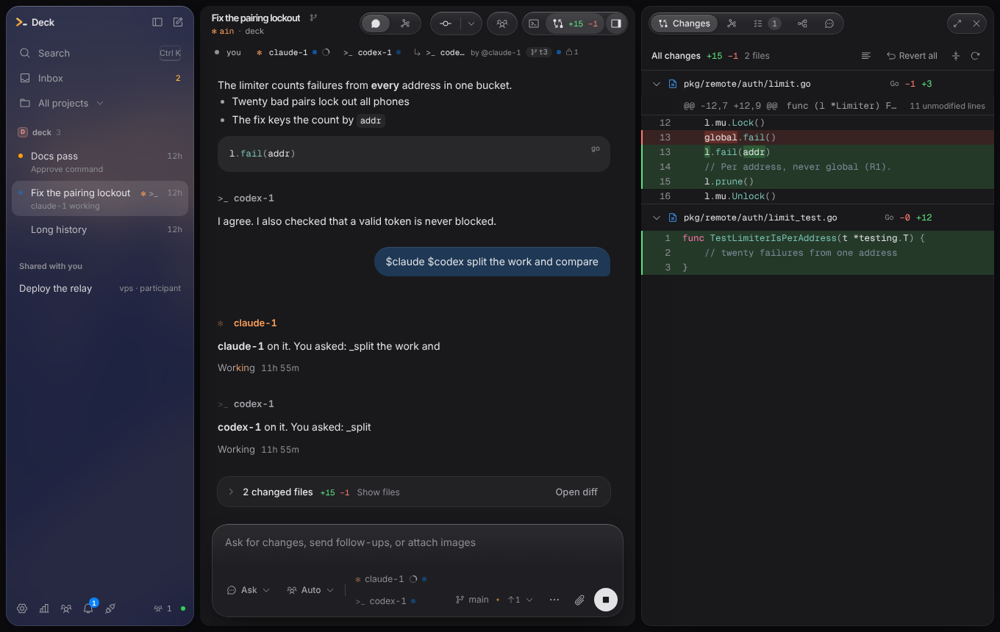

# Deck desktop shell

The Deck desktop app. Like Claude Desktop with Claude Code, it carries the
Deck engine inside it: open a project folder and work with its agents, no
separate CLI to install. It shows the threads of every open project, the
agents in each thread and their work, and it runs many agents at once. The
layout is a sidebar of projects and threads, a chat timeline, a composer
with its agents, the room's tabs (changes, tasks, agents, side chat) and a
terminal drawer.



## Two ways to reach a Deck

| | Open a folder | Pair with a Deck |
|---|---|---|
| For | A project on this computer | A Deck on another computer, or one you started yourself |
| Deck command | The app runs its own engine (`deck serve --rpc`) | You run `deck remote` (`--lan` for another computer) |
| Transport | gRPC (`proto/deck/v1/deck.proto`) on a Unix socket | WebSocket, protocol v2 (`docs/remote-contract.md`) |
| Trust | A token made for this launch, printed on Deck's stdout | A one-time pairing code, then a device token |
| Lifetime | Deck stops when you close the folder or quit the app | Deck runs until you stop it |
| Events | Every session's events, live | The open session's messages only |
| Yolo mode | Allowed | Only with `deck remote devices --allow-yolo <id>` |

Use **Open a folder** for your own projects on this computer. It is the
default. Use **Pair with a Deck** for a Deck on
another machine, or when Deck already runs in a terminal and you want to
watch it from the window too.

## Run it

You need Node 22 and Go (to build the engine).

```sh
cd desktop-shell
npm ci
npm run build
npm run build:deck   # the engine, into bin/deck
npm start
```

The app finds its engine in this order: `DECK_BIN`, the engine it ships
with (`bin/` here, `resources/bin` in an installed app), then `deck` on
your PATH. It starts the engine with your login shell's PATH, so agent CLIs
installed in `~/.local/bin`, Homebrew or similar are found even when the
app is opened from a dock or launcher. The engine needs at least one agent
CLI (claude, codex, opencode or antigravity, which runs as `agy`).

**First run.** With no recent folder and no pairing, the app opens on the
Welcome: Open a folder, Pair with a Deck, and Your agents. Your agents lists
each agent CLI with the path where the app found it on the login shell's
PATH, or with an install line and a link. "Check again" looks again after an
install. When the engine finds no agent CLI, the Welcome shows this list in
place of the error. Any other start error shows the engine's last lines,
Open logs and Try again. When the app cannot find its engine, the Welcome
says so: run `npm run build:deck`, or set `DECK_BIN`. "Welcome" in the
palette (Ctrl+K) opens it again.

On later launches the app reopens the projects that were open when it quit,
else shows "What should we work on?":

- **Open a folder.** Click "Add project" and pick the folder, or click a
  recent one. Several projects can be open at once; each runs its own
  engine, which stops when you close the project. The app remembers the
  last eight folders.
- **Pair with a Deck.** In the project, run `deck remote`. In another
  terminal, run `deck remote pair`. Paste the link it prints
  (`http://127.0.0.1:7878/#pair=…`) and click Pair. For another computer,
  run `deck remote --lan` there and paste the invite line (`deck://pair?…`).
  The invite carries the certificate fingerprint. The app remembers each
  pairing.

To work on the renderer with hot reload, run `npm run dev` and start
Electron with `DECK_DESKTOP_DEV_URL=http://localhost:5173 npm start`.

## Use it

The window takes its structure from [T3 Code](https://github.com/pingdotgg/t3code)
(MIT): the same sidebar, chat, composer, diff panel and settings, with
Deck's sessions as threads and Deck's agents in place of T3's providers.
The default look, Apple, is a native Mac window
([docs/design-apple.md](docs/design-apple.md)): the system font, the
system blue, hairline separators, a 52px toolbar with a title over a
subtitle, segmented controls, frosted menus and sheets, and on a Mac the
system's translucent sidebar material. Your turns are bubbles on the
right; agent replies have no bubble and start with a small mono index
such as `✳ claude-1` in the agent's hue. Apple follows light and dark.
Deck's other look, Tabletop (a felt table at night, with warm ink, paper
text and one amber lamp), and T3's look stay in the theme catalog.

- **Projects.** As in T3 Code, the sidebar lists the threads of every open
  project together, grouped by project (or in one list, in Settings). The
  project filter at the top shows all projects or one, adds a project,
  reopens a recent one or pairs with a Deck. Each group has its own new
  thread and close buttons.
- **Threads.** Each thread is a room in one state: working (an amber dot),
  needs you (a shield: an approval, a question, a blocked or failed task),
  overlap (two agents changed the same file), changes to review, done (a
  check), or idle. Under the title a line in small type names the thing:
  "Approve command", "Task blocked: Map the limiter", "codex-2 and claude-1
  both changed auth.go", "Finished". Rows of the open project show it
  always; rows of other projects show it on hover. A room that needs you,
  finished or overlaps moves to the top of its group. "Needs you" holds
  until you answer, write in the room or the agent moves on; opening the
  room does not clear it. Review and done clear when you open the room. A
  working row carries a rail in the hue of its agent. Card rows (in
  Settings) add the project and the last message. Quiet threads older than
  three days fold into Settled. Double-click a title to rename it; hover or
  focus a row to delete it. Right-click a row for Rename, Archive and
  Delete. With a local Deck, the engine also says what a room waits for
  (an approval, a question, an error or a blocked task), and the room needs
  you at once, before the next poll of its agents. A blocked task holds
  until a retry or a cancel changes it. The engine marks its overlap notes;
  against an older engine the app reads them by their words.
- **Inbox.** The sidebar's Inbox (or "Open inbox" in the palette) lists,
  across every open project, what waits for you: approvals with Approve,
  Decline and Always allow, contract proposals with Accept and Decline,
  overlaps, rooms to review, finished rooms and notices from rooms you are
  not in. `j` and `k` move, `y` and `n` answer, Enter opens the room, in
  its own project. Notices from the room you are in show as toasts; each
  toast has a close button.
- **Notifications.** While the window is in the background, the app sends a
  notification when a room needs you or finishes, named "project · room:
  what". A click brings the window up on that room. There is none while you
  have a message queued in that room. The dock or taskbar shows how many
  items need you: a count on macOS and Linux, a dot on Windows. Settings >
  General sets notifications to all, needs you only or none, and the sound
  on or off.
- **New thread** (Ctrl+N, Cmd+N) opens the empty screen. Three cards there
  start the message: One agent (`$claude `), Split the work (`$claude
  $codex+ `, with the kinds that are installed) and Race three
  (`$claude×3 `). The first message makes the thread, named after its first
  line. Empty tabs and pages say what shows there and how it gets there.
- **Chat.** A finished reply folds its tool calls and thinking behind
  "Worked for …"; the answer stays in view. A tool's output shows its first
  40 lines; "Show all" shows the rest. The thread's changed files show
  under the last reply; "Open diff" opens them in the diff panel. The
  timeline follows new messages while you are at the bottom. When you
  scroll up, it stops, and "Jump to latest" takes you back. A room of more
  than 200 messages renders only the messages in view; so does a list of
  more than 200 threads in the sidebar.
- **Composer.** The strip under the composer holds the mode (Plan, Ask or
  Yolo) and picks who the message goes to: one chip per agent of the
  thread, with its glyph, name, context use as a thin ring and a status
  dot (amber while it works, the warning colour while it waits for an
  approval). A member shows its role after its name when it came from a
  profile. Click a chip to address the agent (`$codex-1`), again to take
  it out; several chips address each. The ghost "+" starts another agent
  of a kind, with a model and effort when you pick one. When the
  engine reports a plan window of the agent's kind over 80% full, the chip
  shows an amber "limit 85%" tag; its tooltip says when the window resets.
  The app asks for the limits at most once a minute, and only while the
  strip shows. While agents work and the prompt is empty, send turns into
  stop.
  - **Modes.** When the open thread switches to Yolo (the mode chip,
    Ctrl+Shift+Y, `/yolo` or another device), a shockwave crosses the
    window, as in the terminal, and the Yolo chip keeps a
    slow rainbow border while the thread stays in Yolo. A click or Escape
    ends the wave. Settings > Appearance > Motion follows the system by
    default; Reduced turns the wave off with the rest of the motion, and
    "Play the Yolo effect" turns off the wave alone. Without the wave the
    chip flashes amber.
  - **`@` agents and people.** Type `@` for "Agents and people": the
    thread's members by name, each kind, the saved profiles (Settings >
    Agents > Profiles) and, on a team, your teammates. Each row shows the
    glyph in its hue, the name and the role. `@codex` reaches a free codex
    or starts one, `@codex+` starts another, `@codex*` reaches every
    codex, `@all` every agent, and `@charles` starts the agent of the
    profile named charles (a later `@charles` reaches the same one). `$`
    is the older sigil and still works everywhere: `$` opens the agents
    alone and inserts `$codex`. A Deck from before named agents reads only
    `$`; there `@` keeps picking files and the placeholder says `$`.
  - **Slash commands.** Type `/` at the start of the message for the
    commands: `/plan`, `/ask` and `/yolo` set the mode (Yolo still asks
    first), `/new [title]` starts a thread, `/race <n> [kind] [judge]
    <brief>` races two to six agents of a kind (the room's first kind when
    you name none), `/share` opens the share popover, `/stop` stops all
    agents and `/clear` clears the draft. Other text after a `/` is an
    ordinary message.
  - **`#` files.** Type `#` for the room's changed files, matched loosely
    by name and path; the pick goes in as a path in backticks, the same
    text an `@` file pick inserted before, so the agents read what they
    always did. `@` before something path-like (it holds a `/` or ends in
    `.ext`, as in `@src/` or `@main.go`) still opens the files. A local Deck
    that serves `ListFiles` adds the other files of the room's tree after
    the changed ones (up to 20, through the repository's ignore rules). The
    app asks once the typing stops for 120 ms, and only the latest answer
    shows.
  - **Queue or steer.** While an agent works, Enter queues the message
    until its turn ends, and Ctrl+Enter steers it into the running turn. A
    line in the strip and the send button's tooltip say which. With
    Ctrl+Enter to send (Settings), Ctrl+Enter queues and Ctrl+Shift+Enter
    steers. In Tasks, each waiting message moves up or down, and Edit puts
    it back in the composer and takes it out of the queue.
  - **History.** `↑` in an empty composer brings back what you sent in this
    room, newest first, up to the last 50; `↓` goes forward again, and
    typing leaves the history.
  - **Images.** Paste, drop or attach an image; each shows as a small
    thumbnail with a remove button.
- **Approvals.** The open thread's approval sits on top of the composer:
  Decline, Always allow this session, or Approve. It names who may answer:
  you, and the teammates the thread is shared with as editors. The Inbox
  lists the approvals of every room.
- **Room.** A thread is a room. The header shows the room's index (the
  glyph of its first agent and the last three characters of the thread's
  id, in that agent's hue), the title (double-click it to rename), the git
  actions, who follows the room, and the side panel's toggles. The sidebar
  rows and the plan cards show the same index. Under the header, the lane
  strip has a chip for each one in the room: you, each agent with its
  state (working, waiting, idle or error), its context use as a ring and
  the number of paths it holds, and after the agents each teammate who
  follows the room with their role. Click a chip to show that lane's
  messages alone; click it again to show all. An agent's chip also opens
  its model and effort, the paths it holds, Stop, and Steer, which
  addresses the composer to it. A local Deck reports each lease as the
  agent takes or ends it; the app reads the agents tree for an agent it
  has no report for. The strip wraps to two lines at most. Past that, the lanes that do
  not fit fold into "+N", from the end: teammates first, then idle agents.
  You and the agents that work, wait or failed always show. Click "+N" for
  a list of the folded lanes.
- **Tasks and agents.** The side panel holds the room's tabs: Changes,
  Tasks, Agents and Side chat. Changes shows every changed file with line
  numbers. Tasks shows the messages that wait for a busy agent (send now,
  edit, move up or down, or cancel), the task board (cancel, retry, steer, apply or discard a
  worktree result), orchestration on or off, and races. Apply and Discard
  first show the task's files, with their diff when the work tree is on the
  task's branch, and ask. A race starts two to six agents of one kind on
  one brief, each on a worktree of its own; you keep the best entry. Agents
  shows the tree of agents and subagents, each with its model, effort,
  context, cost, leases and the tool it runs. In a window narrower than
  1100px, the side panel floats over the room; its toggle in the header
  shows and hides it.
- **Branches.** Under the start cards, "On its own branch" starts the new
  thread on a git worktree and branch of its own (`deck/<id>`). It is on
  by default, the app remembers the choice, and it shows only for a Deck
  that can do it. The row shows the branch in small mono type, and the room
  header shows it next to the title. Its menu offers Apply to my tree
  (writes the branch's changes into your tree, then lists the files; the
  toast offers Undo for 10 seconds, and the menu offers Undo last apply
  until you apply again), Discard branch (asks first, with the branch and the count of changed
  files) and, for a thread in the shared tree, Move to its own branch (not
  while agents work).
- **Diffs.** Changes colours each file's code by its language (Go,
  TypeScript, Python, Rust and twenty more) and names the language in the
  file's header. Each hunk opens with its `@@` range and the function it
  sits in. A changed line marks the words that changed. Long runs of
  unchanged lines fold; click to show them. In an expanded panel, the
  header's toggle shows the old file next to the new one, line by line,
  and the wrap toggle wraps long lines instead of scrolling each file
  sideways. Tabs show as four spaces. Code blocks in agent replies take the
  same colours. Prism (`prismjs`) only splits the text into tokens; each
  token becomes a span, never HTML.
- **Revert.** In Changes, each file has a Revert button and the header has
  Revert all. Each asks first and names the file or the count. The files go
  back to how they were before the thread changed them. A toast offers
  Undo for 10 seconds, and the room's timeline shows a line such as "You
  reverted a.go". Nothing goes to the agents.
- **Archive.** Hover a row, or right-click it, to archive the thread. A room
  whose agents work cannot be archived; the button says why. Deck archives
  it at once, the row goes, and a toast offers Undo for 5 seconds; Undo
  asks Deck to unarchive it. With an older Deck that cannot unarchive, the
  app waits those 5 seconds before it asks Deck to archive, and Undo
  cancels the wait. Archived rooms wait in an Archived fold at the bottom
  of their project, closed at first; hover a row there to unarchive it. A
  new message in an archived room brings it back too.
- **Images.** An image in a message shows as a thumbnail; click it to see
  it larger. With an older Deck, the image shows as its name.
- **Races.** The race form in Tasks has a Judge switch, on by default: one
  more agent of the kind ranks the entries. With a Deck that serves
  `StartRace`, the form and `/race` start the race through it
  (`/race 3 codex judge <brief>`). An older Deck gets the race as a message
  (`$codex×3 <brief>`), and the form has no Judge switch.
- **Plans.** In Plan mode, an agent's numbered steps show as a card with
  Approve, Edit and Ask. Approve switches the thread to Ask (or back to
  Yolo when it was Yolo before Plan) and tells the agent to go ahead. Edit
  puts the steps in the composer; Ask addresses the agent there. Settings,
  Agents, "Approve plans automatically" approves each plan as it appears
  and says so on the card.
- **Message actions.** Hover a message to copy it. Your own messages offer
  Edit and resend: the text goes back to the composer, and Send replaces
  the message and runs the thread again from it. The last reply offers
  Retry (your message again, to the same agent) and Continue.
- **Line comments.** In the diff panel, hover a line and click `+`. The
  comment goes to the composer with the file, the line number and the line
  quoted, addressed to the agent that last changed the file. Comments
  collect in one draft; the diff header counts them and sends them.
- **Take-over.** Stop the agents, change the files yourself, and a line
  over the composer says how many files you changed since the stop.
  "Continue with my changes" tells the stopped agent to go on and lists
  those files.
- **Side chat.** Ask another agent about what the open thread's agents are
  doing, without writing into that thread. The side chat gets a digest of
  the thread and lives in its own hidden thread.
- **Sharing** (multiplayer). Share in the room header shares the room with
  a teammate as observer (reads it), participant (also writes in it) or
  editor (also answers its approvals). When someone follows the room, the
  button shows their initials. Rooms that teammates share with you are in
  the sidebar under "Shared with you", with the teammate and your role.
  One opens in the room view: read-only for an observer, with a composer
  for a participant or editor, and with Approve and Decline for an editor.
  The sidebar footer counts the teammates online; click it for the Team
  page: teammates and what their agents do, team chat, and contracts
  (propose, accept, decline). Beside the count, a dot shows the connection
  (its tooltip names it); click it for the connection settings. A sidebar
  wider than 260px also shows the word.
- **Git.** The strip under the composer shows the branch; switch or create
  one there. The header's git menu commits (all changes, with a message),
  pushes, pulls, and opens or merges a pull request (through `gh`).
- **Terminal** (Ctrl+J). A drawer of shells in the project folder. Tabs keep
  running while the drawer is hidden; drag its top edge to resize it. The
  shell is `$SHELL` on macOS and Linux. On Windows (10 version 1809 or
  later, through ConPTY) it is PowerShell 7, else Windows PowerShell, else
  the command prompt.
- **Ports and preview.** When a terminal or an agent's command prints where
  a dev server listens (`Local: http://localhost:5173/`, `listening on port
  3000`), the port shows as a chip, such as `:3000` with a green dot, in the
  room header and in the terminal tab that printed it. Main checks every 5
  seconds that something still listens there; when it stops, the chip goes.
  Click a chip to open the page in the Preview tab of the side panel; its
  arrow also has Open in browser and Copy URL. The palette has "Preview
  :3000" for each open port. The Preview tab has Back, Forward, Reload, Open
  in browser, an address bar (the host is fixed, the path is yours) and a
  width: Responsive, 390, 768 or 1280 (a width wider than the panel zooms
  the page out). A terminal that runs a dev server has a Stop button, which
  sends Ctrl+C. Ports show for a project on this computer only.
- **Usage.** Tokens and cost per day, agent and model, the plan's limits,
  a heat map of the last 20 weeks and when you work.
- **Settings** (the gear, or Ctrl+,): send key, Yolo confirmation, folding,
  time format, motion and the Yolo effect, light or dark or the system's, the theme (Apple, Tabletop, T3,
  Tokyo Night, Catppuccin Mocha, Nord, Rosé Pine, Dracula, Solarized Light, GitHub
  Light) and accent colour (or Graphite), the diff theme (Match app theme, GitHub Dark,
  GitHub Light, One Dark, Dracula, Tokyo Night, Catppuccin Mocha,
  Solarized or Monochrome, with a live preview), unified or split diffs and
  wrap, card or compact thread rows, grouping by project, the agent kinds,
  the connection and the shortcuts. Settings > Agents > Profiles lists the
  named agents of the global (`~/.config/deck/deck.json`) and the
  project's `deck.json`, and creates, edits and deletes them: a name, the
  kind it runs, a model and effort, a one-line role, standing
  instructions, a voice, the paths it keeps to and a colour. The fields
  say what is wrong as you leave them (a name with a space or a sigil,
  Deck's own words, a kind, a teammate's name, a taken name), and Deck
  checks again when it saves. A Deck from before profiles says so there.
- **Keys.** On a Mac, Cmd takes the place of Ctrl. Ctrl+K searches threads
  and commands. Ctrl+N starts a thread, Ctrl+O opens a folder, Ctrl+,
  opens Settings. Ctrl+B hides the sidebar, Ctrl+J the terminal.
  Ctrl+Shift+Y turns Yolo mode on and off, so Ctrl+Y stays Redo in a text
  field. Ctrl+Alt+L goes to the next room that needs you, in any open
  project. Ctrl+1 to Ctrl+9 open the first nine rooms of the sidebar; hold
  Ctrl to see their numbers. Ctrl+= and Ctrl+- zoom, Ctrl+0 goes back to
  100%; the app keeps the zoom. Enter sends, or queues for a busy agent;
  Ctrl+Enter steers a busy agent. Shift+Enter adds a line. `↑` in an empty
  composer recalls what you sent.
- **Palette** (Ctrl+K). It searches the threads of every open project by
  title and by the branch their agents work on. From three letters on it
  also asks each Deck for the messages that hold the words, in every room
  that is not archived, loaded or not; a message hit shows the text around
  the match under the title, and opening it opens the room at that
  message. The messages of loaded rooms are searched too. Each result names its project, and opening one switches to that
  project. Every menu command is there with its key. Start with `>` to list
  commands alone.
- **Menus.** The menu bar holds every command and its key. Reload and the
  developer tools are there only in a development build. Right-click a
  text field, a selection, a link or an image for the usual actions; a link
  opens in the browser.
- **Window.** The app remembers the window's size, place and whether it
  was maximized, and opens it on a display that is still there.
- **Folders and links.** Drop a folder on the window to open it. So does
  `deck-desktop <folder>` (or `Deck <folder>`) on the command line. A
  `deck://open?path=<folder>` link asks first ("Open <folder> in Deck?"),
  since any web page can open such a link. A `deck://pair?…` link opens
  the pairing form with the invite filled in; click Pair to confirm. An
  installed app registers `deck://`; a development build does not.
- **Updates.** An installed app checks the GitHub releases of
  `dev-dami/deck-releases` 10 seconds after it starts and every 6 hours,
  and downloads a new version in the background. "Update ready · Restart"
  then shows in the sidebar footer; the update also installs when you
  quit. Help > Check for updates checks now. A development build does not
  update.
- **Logs.** The app writes `main.log`: what main does, each engine's
  stderr, errors in the window, and crashes. Help > Open logs folder, or
  Settings > Connection > About, opens its folder (`~/Library/Logs/Deck` on
  a Mac, `logs` in the app's data folder elsewhere). Settings > Connection >
  About also shows the app, engine, Electron and Chromium versions.
- **Fonts.** The window uses Geist Sans and Geist Mono, under the SIL Open
  Font License 1.1. The two variable woff2 files and the licence are copied
  from the `geist` npm package (1.7.2) into `src/renderer/fonts/`, and the
  build bundles them.

## Build, test and package

| Script | What it does |
|---|---|
| `npm run dev` | Vite dev server for the renderer |
| `npm run build` | Renderer into `dist/renderer`; main, preload and `deck.proto` into `dist/app` |
| `npm start` | Electron on the build |
| `npm test` | Unit tests (Vitest) |
| `npm run e2e` | Build, then Playwright: the renderer in Chromium over both transports, and the whole app in Electron |
| `npm run smoke` | Build, then open the window, check that the app mounts, and quit |
| `npm run lint` | `tsc --noEmit` for the renderer and for main |
| `npm run build:deck` | The Deck engine from the repository root into `bin/deck` |
| `npm run dist` | Build the app and the engine, then package with electron-builder into `release/` |

CI runs the `desktop` job of `.github/workflows/ci.yml` on every push and
pull request: lint, unit tests, build, then the e2e tests and the smoke
test under xvfb on Ubuntu.

On a Linux machine without a display, run `xvfb-run -a npm run e2e` and
`xvfb-run -a npm run smoke`. As root in a container, Chromium needs
`--no-sandbox`; the Electron e2e tests add it for root only.

The tests use fakes in `test/`:

- `fake-server.ts` is a protocol v2 Deck: the pair route and the WebSocket
  over an in-memory project. It decodes every request with the shared
  guards, so a malformed call fails the test.
- `fake-grpc.ts` is a `deck serve --rpc`: the `deck.v1.Deck` service from
  the same `.proto`, on a Unix socket behind the token, over the same
  in-memory project.
- `fake-deck.cjs` stands in for the `deck` binary. It prints the fake gRPC
  server's handshake and lives until its stdin closes, as Deck does.

Each e2e test starts a fake, pairs with it or opens a folder through it,
and then plays the Deck's part from the test: a reply, an approval or a
notice (`test/e2e/harness.ts` gives the page the real main-process host).
To use a Chromium that is already installed, set `PLAYWRIGHT_BROWSERS_PATH`
to its folder.

`npm run dist` makes a dmg and zip on macOS, an AppImage and deb on Linux,
and an NSIS installer on Windows, for the machine it runs on. The engine
goes into `resources/bin`; build on each platform (or set `GOOS` and
`GOARCH` for `build:deck`) to package for it. `npx electron-builder --linux
dir` makes an unpacked app in `release/linux-unpacked`, which
`test/e2e/packaged.spec.ts` opens with a bare PATH to check that the app
starts its own engine.

## Architecture

```
renderer (React, sandboxed)                  main process (Node)                         Deck
  DeckClient ─┬─ Controller + RpcClient  ─IPC─  link.ts: one WebSocket, pinned  ══WS══  deck remote
              └─ RpcDeckClient           ─IPC─  decks.ts: gRPC client            ══gRPC══ deck serve --rpc
  shared reducer (AppState) → the UI             host.ts: the only surface, checks every argument
```

- **One state, two transports.** The UI renders the phone client's
  `AppState` and calls a small `DeckClient` interface
  (`src/renderer/client.ts`). Two classes implement it:
  - the phone client's `Controller`, unchanged, for protocol v2. Its socket
    is `BridgeSocket`, which main owns;
  - `RpcDeckClient` (`rpcClient.ts`) for a local Deck. It calls the
    `deck.v1` methods through main and maps each answer and event to the
    same entities (`rpcMap.ts`). Each mapped entity goes through the shared
    guard, so the state holds only what a v2 server could also send.
- **Main process** (`src/main/`): `host.ts` is the one surface the window
  calls. `decks.ts` starts `deck serve --rpc`, reads the handshake, dials
  the socket and keeps the process. When the process stops by itself, the
  window gets its last stderr lines and `restartFolder` starts it again
  under the same id. `pin.ts`, `pair.ts` and `link.ts` are
  the v2 side. `servers.ts` keeps pairings, `recent.ts` the recent folders.
  `menu.ts` and `contextMenu.ts` build the menus from plain templates;
  `windowState.ts` keeps `window.json`; `log.ts` writes the log and keeps
  the app alive after an error; `update.ts` runs electron-updater;
  `launch.ts` reads deck:// links and folder arguments. `preview.ts` probes
  ports and owns the Preview tab's view. Menu commands, links, updates and
  the preview's state reach the window as events, like the rpc stream.
- `src/preload/preload.ts` exposes `window.deck`: the host methods over IPC,
  the socket, rpc, menu, link, update and notification-click event streams,
  and the path of a
  folder dropped on the window. Nothing else.
- `src/shared/` holds the bridge types and the CSP.
- **The UI** is React with Tailwind CSS v4, rebuilt after T3 Code's
  components (`Sidebar`, `ChatHeader`, `MessagesTimeline`, `ChatComposer`,
  `DiffPanel`, the settings layout). `src/renderer/styles.css` holds the
  theme tokens and the Liquid Glass materials (`docs/design-glass.md`),
  `src/renderer/ui/kit/` the primitives (button, badge, menu, segmented)
  after T3's `components/ui`, and Phosphor draws the icons
  (`ui/icons.tsx`). Tailwind
  builds one stylesheet, so the CSP's `style-src 'self'` holds. xterm.js
  writes its rules into `<style>` elements, which the CSP blocks;
  `ui/Terminal.tsx` copies them into a constructed stylesheet instead. The
  window's own settings (`prefs.ts`) live in its localStorage.
- **The UI's files.** `ui/Shell.tsx` lays out one project's window and
  picks the page; `ui/useShell.ts` holds its navigation, keys, menu and
  palette commands, and `ui/useRoom.ts` the open room's state and send path
  (first message, steer, slash commands, Yolo). `ui/Room.tsx` draws the
  room (header, lanes, timeline, composer), `ui/NewThread.tsx` the empty
  room, and `ui/Toasts.tsx` and `ui/EngineStopped.tsx` what their names
  say. The sidebar is `ui/Sidebar.tsx` with `ui/ThreadRow.tsx`,
  `ui/ProjectGroup.tsx` (groups, the project filter, shared rooms) and
  `ui/SidebarFooter.tsx`. `ui/kit/virtual.tsx` renders only the rows in
  view of a list longer than 200 rows (the timeline and the thread list).
- **App state.** `appState.ts` keeps each open project's UI state (open
  thread, panel, unread marks, drafts) outside the React tree, so a switch
  between projects keeps it; drafts also persist in localStorage
  (`drafts.ts`). Terminals belong to their project in a module store in
  `ui/Terminal.tsx`, so their shells run on while another project shows.
  Components read slices of the shared `AppState` (`select.ts`), so the
  tokens of a thread in the background do not render the sidebar or the
  open timeline.
- **Attention.** `appState.ts` computes each room's state once per
  project with the pure `roomStatus` (`attention.ts`), from the project's
  store and one poller for its board and agents (`crewState.ts`, every 3
  seconds while an agent works, else every 10), and the sidebar, the inbox,
  the badge and the notifications all read that result.

### What the rpc transport adds, and what the app uses

- **Every session's events.** The v2 hub sends message events only for
  the focused session. The rpc stream sends all of them, so a thread in the
  background fills in live and is marked unread as soon as an agent writes
  in it. Opening it needs no refetch.
- **Resume by (epoch, seq).** When the stream ends, the client subscribes
  again from its last event. A `Ready` with `resync` makes it refetch.
- **Yolo** is allowed: the caller is the person at this machine.
- **No caps.** Text and diffs are not cut; images travel as bytes.
- **Error messages.** A refused call carries Deck's own message; the app
  shows it in a toast.
- **Room events.** `Notice.via` marks the engine's overlap notes,
  `lease_changed` reports each lease an agent takes or ends, and each
  `Session` carries `attention` (approval, question, error or blocked), its
  isolated `branch` and `archived`. `rpcMap.ts` keeps them by session id in
  `roomMeta.ts`, beside the shared state.
- **Isolation.** `createSession(title, true)` and `isolateSession` put a
  thread on a worktree and branch of its own. `applyIsolated` writes its
  changes into the shared tree, `undoApply` takes the last apply back
  while its files are as the apply left them, and `unisolate` discards the
  worktree.
- **Revert.** `revertFiles` puts files back as they were before a message,
  and `undoRevert` undoes the latest revert.
- **Archive.** `archiveSession` stops a thread's agents and marks it
  archived, and `unarchiveSession` brings it back without starting them; a
  new message brings it back too. An empty thread can be archived. Against
  a Deck without `UnarchiveSession`, the app's Undo holds the archive back
  for 5 seconds (`archive.ts`).
- **Races.** `startRace` has several agents of one kind do one brief, each
  on a worktree of its own, with an optional judge.
- **Files.** `listFiles` lists the thread's tree through the repository's
  ignore rules, fuzzy on a query, for the `#` picker.
- **Images.** `readImage` returns the bytes of a message's image part, up
  to 10 MB, by session, message and index; Deck finds them, so no path
  leaves the window. Main hands them over as a `Uint8Array`, and the
  timeline shows them through a `blob:` URL.
- **Search.** `searchMessages` finds words in the messages of every room of
  the project that is not archived, newest first, from Deck's message
  store, without loading the rooms.
- **Capabilities.** `Info.capabilities` names the optional methods. Each
  call above does nothing against a Deck that lacks its method, so the app
  works with an older engine. `Info.clis` lists the agent CLIs Deck looks
  for and where it found them.

`AgentLine` is the same in both: `busy` only, no richer status.

### Shared code

The renderer imports the phone client's sources from `pkg/remote/web/src`
through the `@web` alias: `protocol.ts` (wire types and guards), `rpc.ts`,
`controller.ts`, `state.ts`, `markdown.ts`, `diff.ts`, `theme.ts` and a few
small helpers. They are not copied. `bun test` in `pkg/remote/web` checks
the guards against the fixtures in `pkg/remote/wire/testdata`. A protocol
change that breaks the desktop fails `npm run lint` here. Main loads the
gRPC service from `proto/deck/v1/deck.proto` at run time; the build copies
the file next to it.

## Security

For both transports:

- **No token in the window.** The renderer never sees a token: not the v2
  device token, not the rpc launch token. Main makes every connection and
  every call.
- **No Node in the window.** `contextIsolation`, `sandbox` and no
  `nodeIntegration`. The preload exposes a fixed list of methods. Main
  checks the type of each argument; an rpc call must name a known unary
  method of `deck.v1` and pass a plain object.
- **CSP.** The page loads from `app://deck` with `default-src 'none'`,
  `script-src 'self'`, `style-src 'self'` and `connect-src 'none'`: the
  window cannot open a network connection of its own. Main sends the policy
  as a header, and the built page carries it as a meta tag.
- **Safe rendering.** Agent text becomes a node tree (the shared
  `markdown.ts`), never HTML. A test bans `innerHTML` and its relatives in
  `src/`. Links open in the system browser, and only http(s) links are
  links. Syntax colour comes from Prism's token stream, drawn as React
  spans. Prism runs in manual mode, so it never scans or writes the page,
  and its grammars are bundled, so nothing loads at run time.
- **Locked window.** The window cannot navigate away or open a new window.
  Permission requests (camera, notifications and others) are denied. Main
  shows Deck's notifications itself (`notify.ts`), from a title, a body and
  a tag that `host.ts` checks.

Preview:

- **A view of its own.** The Preview tab's page is not part of the window.
  Main shows it in a separate `WebContentsView` with its own session (the
  `preview` partition, kept in memory only), `sandbox`, `contextIsolation`,
  no `nodeIntegration`, `webSecurity` and no preload. It has no bridge and
  no IPC: main accepts a host call only from the window's own page, and a
  test checks that a call from the view is refused. The page runs with its
  own headers; the window's CSP does not change.
- **Loopback only.** The view loads only `http://localhost:<port>` or
  `http://127.0.0.1:<port>`, for a port that main's own probe found open.
  Main checks each navigation, redirect and new window: another http(s)
  page opens in the system browser, and anything else is refused. The
  view's session denies every permission and cancels every download.
- **It ends with the room.** Closing the room or the project, a reload and
  quitting the app destroy the view and its page.

Open a folder (rpc):

- Deck listens on a Unix socket that only this user can open (mode 0600 in
  a 0700 folder). There is no TCP port.
- The token is made for one launch, printed once on the stdout pipe that
  only the app reads, kept in main's memory and never stored. Main sends it
  as `authorization: Bearer <token>` on each call.
- Deck lives as long as the app holds its stdin. Closing the folder or
  quitting the app closes stdin, and Deck stops.

Pair with a Deck (v2):

- **Token handling.** The renderer's `hello` carries a placeholder, and
  main writes the real token in. After the hello, main sends only `req`
  frames from the window. When Deck closes with 4401 `token_invalid` or
  4403 (revoked), main forgets the token.
- **Token storage.** Main seals each token with Electron `safeStorage` and
  writes `servers.json` (mode 0600) in the app's data folder. When the
  system has no keychain (`basic_text` on Linux), main writes no token to
  disk. The pairing then lasts until the app quits, and the connect screen
  marks it "until the app quits".
- **Certificate pinning.** A `--lan` Deck uses a self-signed certificate.
  Main opens the TLS connection itself, compares the SHA-256 fingerprint of
  the certificate with the pin from the invite (or the one you typed), and
  only then sends a byte: the pair code or the WebSocket upgrade. A wrong
  certificate stops the connection. Plain HTTP is allowed to loopback only.
  `session.setCertificateVerifyProc` also accepts only a pinned certificate,
  for the case that Chromium ever connects.
